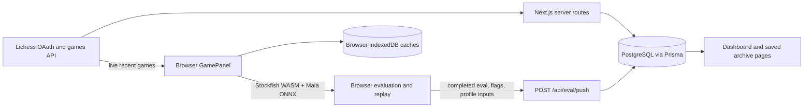

# EightSquare Labs — Project Status and Governing-Agent Handoff

**Snapshot:** 2026-10-20  
**Purpose:** Describe what the repository currently implements, how its data moves, and what remains before product polish or additional feature work. This is a source-grounded handoff, not a claim that every path has been verified against the live database or in a browser.

## 1. Executive overview

EightSquare Labs is a chess-game review and training app built around a deliberate split: Lichess provides game data; expensive chess analysis runs in the user's browser; selected analysis results are persisted to the app's PostgreSQL database so account-level archive and dashboard pages can read them later.

The product currently includes:

- Lichess OAuth sign-in and per-account data ownership.
- Game sync from Lichess into a Prisma/PostgreSQL archive.
- Browser-side Stockfish evaluation and move-quality flagging, with results pushed back to the database.
- A live Lichess game-inspection page with saved-evaluation overlays and interactive Maia spar/replay.
- A database-backed Games archive, saved-game review, Ghost Replay, opening analytics, pattern views, a square heatmap, Daily Puzzle, and Rivalries.
- Base Maia spar plus an opponent-mimic mode that uses locally built opponent signals when the tier resolver allows it.

The feature set is substantial, but several areas remain “implemented in source, validation outstanding.” In particular, the latest square-bias and daily-puzzle migrations must be checked against the actual database, browser flows need a real-account pass, and some analytics are intentionally proxies or partial versions of the larger spec.

## 2. Technology and runtime layout

- **Web:** Next.js 16 App Router, React 19, TypeScript, Tailwind CSS 4.
- **Chess rules/board:** `chess.js` for replay and position construction; Chessground for interactive and static boards.
- **Evaluation:** Stockfish WASM workers and Maia ONNX inference run client-side. The Stockfish engine uses a small worker pool and queued requests. The app proxies Stockfish assets through `/api/stockfish/[asset]`.
- **Server/data:** Auth.js (NextAuth v5 beta), Prisma 6, PostgreSQL (configured for Supabase in this environment).
- **External data:** Lichess public games/account APIs.
- **Client persistence:** IndexedDB for game evaluations and profile caches; localStorage for some UI/account conveniences, dismissal state, and attempt logs.
- **Tests/build commands:** `package.json` has `dev`, `build`, `start`, and `lint`; it has no `test` script. TypeScript is run separately with `npx tsc --noEmit`.

## 3. Architecture and data flow

1. **Sync:** `POST /api/sync` or the Signature page's SyncPanel calls `lib/sync/runSync.ts`. The server fetches the authenticated user's games from Lichess and inserts them into `Game` rows.
2. **Evaluation:** the root review page (`/`) fetches recent games through `GET /api/games`. `GamePanel` runs Stockfish evaluation and feature/flag extraction in the browser for games lacking a persisted `GameEval`.
3. **Persistence:** completed evaluation payloads are sent to `POST /api/eval/push`. The server checks ownership and payload shape, then writes the evaluation and flags and updates aggregated profile rows.
4. **Reading:** `/dashboard/*` archive and analytics views read the signed-in user's persisted database rows. They do not run Stockfish on the server.
5. **Mimic spar:** opponent-history/profile data may be fetched and folded into browser caches; Maia inference and move selection remain in the browser.

### Important source distinction

`GET /api/games` is still a **live Lichess fetch**, currently requesting up to 25 rated rapid games. For a signed-in user viewing their own username, the route overlays persisted flags and evaluated game IDs for matching games. It is not the dashboard archive source. The archive at `/dashboard/games` reads the account-scoped `Game` table.

This distinction is intentional: the root page can inspect a username or opponent live, while dashboard pages are durable account-owned data. A live game that has not yet been synced cannot accept `/api/eval/push`; the games route reports a warning for that case.

## 4. Authentication and ownership

- Auth.js uses a custom Lichess OAuth provider with PKCE/state checks.
- The stable identity key is Lichess `providerAccountId`/account ID, stored as unique `User.lichessId`; username is display data and can change.
- JWT sessions carry the internal database `userId`, username, and plan. Server reads use `getSessionUserId` rather than trusting a client-supplied user ID.
- OAuth tokens are encrypted by `lib/auth/tokenEncryption.ts` before storage. `lib/auth.config.ts` is the edge-safe middleware config; `lib/auth.ts` adds database callbacks for Node/server routes.
- Game rows use an internal database `id` and the external `lichessGameId`. Uniqueness is `(userId, lichessGameId)`, allowing the same Lichess game to be associated with multiple accounts without cross-account ownership collisions.
- Dashboard game, puzzle, rivalry, and analysis APIs scope reads/writes to the authenticated account. The game-review page and Ghost Replay lookup also verify `userId`.

## 5. Persistence model

Defined in `prisma/schema.prisma`:

- **`User`** — Lichess ID, username, free-plan default, encrypted OAuth tokens, sync watermark/timestamps.
- **`Game`** — account-owned Lichess game metadata, moves/clocks JSON, result, color, ratings, opening metadata, and speed.
- **`GameEval`** — one JSON array of per-ply Stockfish `EvalPoint`s per internal game ID.
- **`FlaggedMove`** — persisted move-level observations: SAN/ply, flag type, time/phase ratios, cp loss, causality, severity breakdown, optional pivot/cascade metadata, explanation.
- **`PlayerProfile`** — broad account aggregates such as phase timing, premove rate, opening counts, average opponent rating.
- **`WeaknessProfileRow`** — incrementally accumulated patterns and evaluated game IDs.
- **`BiasProfile`** — square-level bias JSON, evaluated game IDs, sample count, confidence, and legacy rank/file/diagonal JSON columns.
- **`DailyPuzzleState`** — per-user, per-game, per-ply solve/defer/skip state.

The current migration folders are:

1. `20261016220651_init`
2. `20261017132319_add_flaggedmove_ratio`
3. `20261018150000_scope_games_to_user`
4. `20261018150100_clear_plaintext_oauth_tokens`
5. `20261019100000_add_square_bias`
6. `20261019120000_add_daily_puzzle_state`

**Live database migration status has not been checked for this handoff.** Earlier terminal output confirmed the first four migrations were deployed at that time; the square-bias and daily-puzzle migrations were added later. Before relying on those two features in production, run `npx prisma migrate status` against the intended database and apply the pending migrations deliberately. Do not infer live DB state from the local folders.

## 6. Core analysis pipeline

### Game parsing and feature extraction

- `lib/lichess/fetchGames.ts` streams NDJSON, serializes requests process-wide, coalesces identical in-flight calls, uses a short in-memory cache, and retries one 429 after a wait.
- `lib/lichess/parseGame.ts` converts raw Lichess games into the app's `ParsedGame` shape.
- `lib/features/extractFeatures.ts` replays SAN with `chess.js` and derives per-ply mover/color, move number, clock spent/remaining, game phase, captures/checks/forcing moves, likely premoves, and snap decisions.
- `lib/eval/evalCache.ts` evaluates move sequences with Stockfish and stores/retrieves game results in browser IndexedDB. Quality checks detect incomplete or malformed cached evaluation sequences.
- `lib/flags/causality.ts` checks whether a post-move eval deficit holds or recovers later in the game.
- `lib/flags/flagEngine.ts` combines eval loss, timing, severity, recurring-pattern and cascade rules to emit flags such as `collapse`, `pattern_repeat`, `tilt_cascade`, and `time_paradox`.
- `lib/flags/pivotMove.ts` provides on-demand MultiPV attribution for the opponent's preceding move; it is not part of the bulk eval sweep.
- `lib/profile/weaknessProfile.ts`, `lib/bias/updateBiasProfile.ts`, and profile update routines fold per-game data incrementally and track game IDs to avoid duplicate folds.

### Browser versus server costs

Stockfish and Maia computation is client-side. The server persists results but does not run a per-user engine fleet. This keeps compute off the application bill, but an analysis that never finishes in a loaded browser tab may remain unevaluated. The dashboard exposes evaluated/unevaluated counts; there is no background server evaluation queue.

## 7. Product surfaces

### `/` — live game analysis and spar (`components/board/GamePanel.tsx`)

- Loads the previous username when available and accepts username lookup/switching.
- Fetches recent live Lichess rapid games through `/api/games`.
- Reuses server-persisted flags/evaluation IDs for the signed-in user's own games and only runs browser evaluation on missing games.
- Pushes completed evaluation results to `/api/eval/push`; displays save/failure status.
- Shows verdict cards, supports dismissals (new dismissals are flag-type-specific while legacy IDs still suppress flags), jumps to a flagged ply, and can lazily load pivot attribution in the list or replay.
- Includes interactive replay/spar state with Maia and opponent-mimic mode, session IDs to prevent stale inference results, move/clock-aware delay behavior, and guarded attempt logging.
- Opponent data/profile loading is separate from the primary game fetch and uses client caches; Lichess rate limits mean some profile-building work is sequential.

### `/dashboard` — Spar home

- Selects the most recently dated flagged game and displays its worst flagged moment via Ghost Replay.
- Shows a queue of unresolved flagged plies; “unresolved” currently means not marked solved in `DailyPuzzleState`.
- Queue links include `gameId` and `ply`, so the Ghost page opens that exact flagged ply. If `ply` is absent, Ghost Replay uses the game's worst flag; malformed or `>=600` query values are rejected.
- Links to Signature and Daily Puzzle.

### `/dashboard/signature`

- Holds the former player dossier (synced/evaluated game counts, phase timing, premove rate, opening repertoire, recurring patterns, recent flags, last sync) and embeds the Blind Spot Heatmap.
- Includes SyncPanel; initial dashboard load no longer runs sync as a blocking server request.

### `/dashboard/games` and `/dashboard/games/[gameId]`

- Paginated DB-backed archive, newest first, with opening/severity filters and per-move severity timeline.
- Saved-game review replays persisted moves/flags and offers a Ghost Replay entry.
- Displays the retrospective Ambient Pace Signal when the selected game contains a cascade that also appeared in at least two earlier games in the same opening and phase.
- Ambient Pace Signal is careful to say “cascade decline”; the cascade detector does not prove every move was below the player's usual pace.

### `/dashboard/games/[gameId]/ghost`

- Ghost Replay compares the recorded move, Stockfish top choice, and base Maia top choice as three static post-move board positions.
- Shows the stored cp-loss and Stockfish's search score. These are not yet a normalized three-way post-move evaluation comparison.
- “Drill this position” opens PositionSpar at the pre-move FEN. The spar can offer base Maia or opponent mimic according to available tier signals.
- Full multi-ply continuation simulation, synchronized scrubber, and continuation graph are not implemented.

### `/dashboard/openings` and `/dashboard/openings/[eco]`

- Opening Danger Score is a relative within-account ranking based on normalized average cp loss per own move, loss rate, and flag density; scores are not absolute predictions.
- Drill-down shows recurring player moves/positions in the first 14 plies and allows spar from a selected pre-move FEN. It chooses the worst high-severity flagged target for the opening.

### `/dashboard/patterns`

- Displays opening flag rates, phase-by-severity counts, accumulated weakness patterns, and spatial-bias data/status.
- Weakness pattern detection is intentionally coarse (phase buckets + sustained cp-loss candidates), not a tactical motif classifier.
- Phase/severity values are counts; the UI states they are not rates.

### `/dashboard/daily`

- Chooses an unresolved own flagged move whose side-to-move matches the user, reconstructs its pre-move position, and presents an interactive puzzle.
- The current client checks the played move against Stockfish's top move, then persists solved status. Skips are persisted; three skips defer a position, and a shorter skip cooldown is used before it is eligible again.
- This is a single best-move exercise, not a multi-line tactics trainer with a full solution tree.

### `/dashboard/rivalries` and `/dashboard/rivalries/[opponentUsername]`

- Lists opponents with repeated losses using the signed-in user's own game history.
- Detail shows W/L/D and streak, opponent-scoped openings, a flagged-destination distribution, effective-rating signal, and a spar target from the worst high-severity flagged position against that opponent.
- The rivalry heatmap uses persisted flagged moves only. Unflagged move counts and per-move timing for arbitrary opponent filtering are not retained, so it must not be described as a full blunder rate or time-pressure heatmap.

## 8. Maia and opponent mimicry

- `lib/maia/useMaiaWorker.ts`, `boardToTensor.ts`, `moveVocab.ts`, and `eloBuckets.ts` provide local Maia inference and move mapping.
- `lib/maia/rerank.ts` takes Maia logits and can adjust candidate move weights using opponent features, piece activity, opening tree, and time-pressure-related inputs; it includes a Stockfish safety check for selected boosted moves.
- Opponent profiles are built from the opponent's own recent Lichess games and cached in IndexedDB: opening choice tree, piece-activity tendencies, and time-pressure/collapse signals.
- Spar prewarms Maia/opponent profiles while the game is being inspected; playing remains opt-in.
- `resolveOpponentTier` currently gates effective mimic tiers on effective-rating history plus secondary data. Tier 1 requires effective-rating signal and opening-tree or piece-activity signal; Tier 2 requires effective rating and some secondary data; otherwise Tier 3. The exact tier coverage and user experience still need real-account validation.
- Ghost Replay's third comparison board is **base Maia**, not an opponent-specific mimic prediction. Opponent mimicry is engaged in the spar interaction, not in that comparison board.

## 9. API route inventory

| Route | Method | Purpose / source |
|---|---|---|
| `/api/auth/[...nextauth]` | GET/POST | Auth.js Lichess OAuth/session handlers. |
| `/api/sync` | POST | Authenticated incremental sync via `runSync`; supports explicit force behavior through its request handling. |
| `/api/games?username=...` | GET | Live Lichess games + derived profile; overlays saved flags/evaluation IDs for own account. |
| `/api/eval/push` | POST | Validates ownership/payload and transactionally persists eval, flags, and profile aggregates. |
| `/api/dashboard` | GET | Authenticated persisted dossier data. |
| `/api/dashboard/games?page=...` | GET | Authenticated paginated DB game archive. |
| `/api/patterns` | GET | Authenticated persisted pattern data. |
| `/api/openings` | GET | Authenticated opening danger aggregates. |
| `/api/bias` | GET | Authenticated square-bias/heatmap data. |
| `/api/puzzle/solve` | POST | Persists solved state for an owned flagged ply. |
| `/api/puzzle/skip` | POST | Persists skip/cooldown/deferred state for an owned flagged ply. |
| `/api/opponent` | GET | Requires sign-in and recorded games against the named opponent, then fetches opponent features from Lichess. |
| `/api/opponent/effective-rating` | GET | Returns effective-rating signal from the signed-in user's recorded matchup history. |
| `/api/stockfish/[asset]` | GET | Serves/proxies engine assets used by browser evaluation. |

Several dashboard pages call the same server-side data functions directly rather than fetching their companion GET route. The routes still exist for API consumers.

## 10. Current unfinished work and limitations

### Validation and operations

- Verify actual migration state in the intended database; local folders include two migrations added after the last user-reported deploy status.
- Browser-check sync, evaluation save, archive review, Ghost Replay, spar, Daily Puzzle solve/skip, rivalry drill, and heatmap on a real account.
- Revisit historical game/profile backfill for square bias. Incremental profile folding does not itself guarantee old already-evaluated games were folded into newly introduced profile columns.
- There is no server-side eval queue, scheduled sync job, or SparSession persistence/resume.
- No automated test command is defined in `package.json`; there are debug/evaluation pages and standalone scripts, but this handoff does not claim CI coverage.

### Product/analysis gaps

- Ghost Replay has no common post-move eval bar or computed played-vs-Stockfish difference. Any comparison needs score-perspective normalization and mate handling.
- Ghost Replay full-game link currently returns to the saved review but does not establish a persisted, synchronized scrub position in `GameReplay`.
- Ghost Replay scrub bar and multi-ply alternative continuations are deferred.
- Opponent-specific mimic is partial and data-gated; its tier frequency and usefulness have not been validated across a broad sample.
- Weakness patterns are coarse phase-level groupings, not tactical concepts such as forks or back-rank motifs.
- Some bias schema columns (`rankBias`, `fileBias`, `diagonalBias`) are present, but the current square-based updater is the source of truth; do not assume each legacy aggregate is independently produced or validated.
- The `DailyPuzzleState` row stores `gameId` as a scalar and scopes it by `userId` in API logic; it is not currently modeled as a Prisma relation to `Game`.
- “Open” Spar queue means “not solved in Daily Puzzle state,” not “not attempted in any spar surface.” There is no shared drill-completion state.

## 11. Working-tree and validation note

At the time this document was prepared, the working tree had multiple modified and untracked feature files from the ongoing dashboard, heatmap, rivalry, puzzle, ambient-signal, and Ghost Replay work. They have not been committed as part of this handoff. The document is based on source inspection; it does not assert clean migrations, a passing full lint/typecheck after the latest route edits, a successful production build, or a live browser/database run.

## 12. Recommended next actions for the governing agent

1. Check `npx prisma migrate status` against the intended database; apply pending migrations only after confirming the target environment.
2. Run `npx prisma generate`, `npx tsc --noEmit`, `npm run lint`, and a production build, recording exact output. Do this with no process holding Prisma's Windows query-engine DLL if generation reports `EPERM`.
3. Browser-validate core data flow end-to-end: sync a game, let browser analysis finish, verify visible push status, then confirm the saved archive/review reads persisted results.
4. Validate the current feature flow before expanding scope: open a queue item to the exact ply; test Maia and mimic spar separately; solve/skip a Daily Puzzle; inspect one opening and one rivalry drill.
5. Decide whether Ghost Replay Option A requires the shared post-move eval bar and flagged-ply GameReplay positioning now. Keep the multi-ply continuation graph and SparSession persistence as explicitly separate work.
6. Only after this baseline is verified, proceed with larger visual redesign work.
